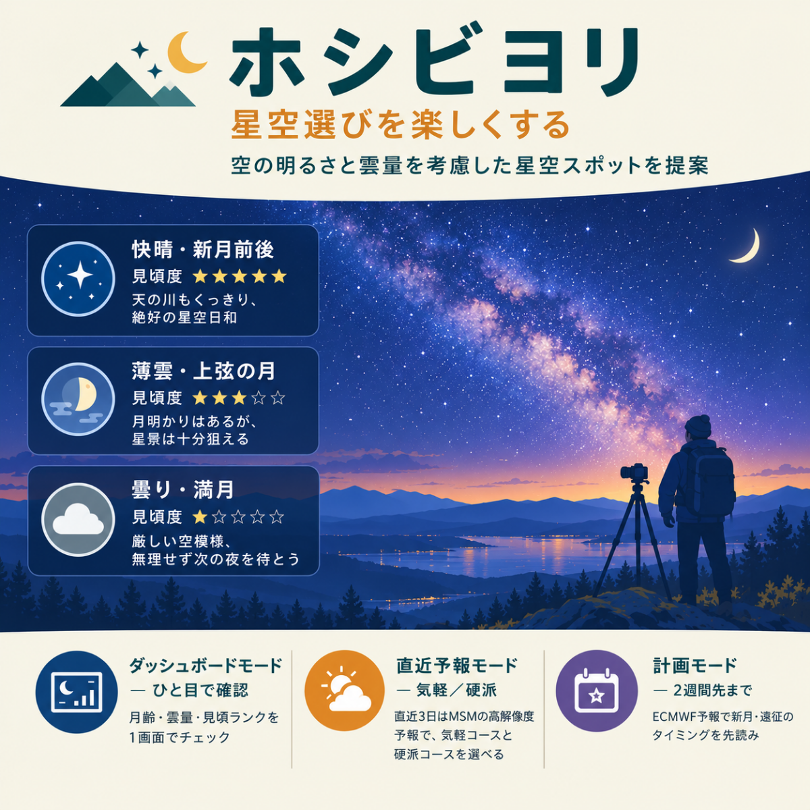

# ホシビヨリ (hoshibiyori)



星景写真撮影に特化した天気予報AIプロジェクト。**「観測者に寄り添う」**を方針に、地表から空を見上げる星空撮影者の目線で、月・雲・光害・地形の条件が揃う「夜 × 場所 × 時間帯」を探す。

登山者向けの姉妹プロジェクト[ヤマビヨリ](https://github.com/ktakemaru/yamabiyori)と同じデータ源(Open-Meteo経由の気象庁MSM+ECMWF IFS)を使うが、評価の軸は独立に設計している。登山者が「稜線がガスに巻かれるか・濡れるか」を見るのに対し、星空撮影者は「頭上の空のどれだけが雲に覆われるか」「薄い巻雲で天の川のコントラストが消えないか」を見る。この違いは`CLAUDE.md`の「観測者に寄り添う」セクションに比較表として記録している。

[](https://github.com/ktakemaru/hoshibiyori/actions/workflows/ci.yml) ライセンス: [MIT](LICENSE)

> **Claude Code プラグインとして使う(最短)** — 1.0.0(個人利用向けの数値予報の整理ツール)です。
>
> ```bash
> claude plugin marketplace add ktakemaru/hoshibiyori
> claude plugin install hoshibiyori@hoshibiyori-marketplace
> ```
>
> 詳細・注意・未確認事項は[「Claude Code プラグインとして使う」](#claude-code-プラグインとして使う)を参照。

## できること(1.0.0、2026-10-24時点)

- **探索モード**(`explore_hoshibiyori.py`) — 直近14夜 × 候補地点146件を「月 → 雲 → 方角」の3段階漏斗で絞り込み、天の川銀河中心が狙える組み合わせをスコア順に出す。
  - 月フィルタ: 天文薄明終了〜開始(太陽高度−18°)のうち月が沈んでいる、または新月に近い時間帯を地点ごとに計算。
  - 雲フィルタ: 時間別の**視界遮蔽雲量**(観測者より上の雲)が30%以下で連続1時間以上続く「晴れ間」があるものだけ残し、その晴れ間を「見頃」として表示。直近約3日は気象庁MSM(約5km格子)、それ以降はECMWF IFS(0.25°)を時刻ごとに自動結合。
  - 方角フィルタ: 対象天体の方位・高度を計算し、地形地平線(国土地理院DEM)を上回り、光害(Black Marble由来のスカイグロー指数ALR。日本で未較正の相対指数)が仮閾値以下の地点だけ残す。
- **レポート生成**(`generate_report.py`) — 探索結果を`report.html`に出力。「気軽コース」(東京から直線250km圏内で、離島・本格登山・リフト要の地点を除く)と「硬派コース」(距離・アクセスを問わず条件のみ)のTOP10(「星空撮影に適した日と場所は?」と聞くと両コースを示す。`scripts/report_courses.py`を使う)、夜景系スポットの別枠、2週間先までの中期見込み(ECMWF、雲量は晴天率の参考表示のみ)、気象庁天気図のスクリーンショット、気象衛星ひまわり赤外画像(「現況の雲の様子(参考)」)を含む。ひまわり画像は実況の参考表示のみで、スコア・順位・足切りには使わない。
- **光害の指数について(相対指数であること)** — 既定の光害は、NASA Black Marble(VNP46A4、2025年)から Duriscoe et al. 2018 の手法で求めたスカイグロー指数 **ALR** です(`--lp-source bm`、既定)。**日本では較正していない相対指数で、空の明るさの絶対値(mag/arcsec²)やボートルスケールではありません**(全天平均で、標高・地形遮蔽は扱いません)。このため画面には ALR と順位だけを出し、足切りには仮閾値(ALR 10.66。従来の判定と同じ件数が通る値で、論文の目安値ではありません)を使います。従来の入力(LPI)と比べた上位の順位差は小さく(見込みの上位10件のうち6件が共通、上位2件は同じ。入れ替わりは光害の減点が2点前後違うだけで動く範囲)、最終的な判断は実地の経験に基づいて行ってください。従来の入力は `--lp-source legacy`(出力は `report_legacy.html`)で使えます。
- **取得失敗の扱い** — Open-Meteoが429(利用上限)を返したら即中止する。失敗セル率(要求したユニークセルのうち取得に失敗した割合)が20%未満なら、`report.html`冒頭に警告バナーを出して続行する(終了コード0)。20%以上、または429の場合は`report.html`を更新せず終了コード2で終わる(閾値は`grid_cache.py`の`FAILED_CELL_RATE_ABORT`)。
- **候補地点マスター**(`stargazing_spots.json`) — 星空撮影の専門家・愛好家サイトのWeb調査と外部リスト取り込みによる主軸146件(`spots`)と、OSM `tourism=viewpoint`由来の参考データ751件(`viewpoint_reference`)。各地点に`site_type`(暗い空/夜景系。ALRの仮閾値で分類)を付与。光害の数値(LPI・簡易ボートル値)は、Lorenz氏のデータ由来のため段階LP3で外した。

## 見上げ型ハイブリッド雲量判定

`step5_cloud_forecast/elevation_cloud.py`。主指標はモデル本来の全層・下層・中層・上層雲量(MSM/ECMWFが直接出力する値)。気圧面別雲量(1000〜300hPa、各面の高度は毎時のジオポテンシャル高度)は**観測者より下の雲を差し引く**用途に限定し、山上の地点では雲海の上に出られるかを「雲海指数」として別に出す。低標高地点では視界遮蔽雲量はモデル本来の全層雲量に一致する。

設計の経緯(気圧面別雲量の全層ランダム重ね合わせが雲を平均+15.6pt過大評価していた検証など)は`CLAUDE.md`に記録している。

## 星空ガイドと星空シミュレーター

「◯◯の星空」を、**時刻スライダー付きの星空シミュレーター**つきの1ページにまとめる機能です(例: 戦場ヶ原)。全天図とパノラマ(国土地理院の標高データから計算した稜線つき)が、時刻と向きに合わせて動きます。「狙える構図」のカードを押すと、その時刻・向き・画角の枠に切り替わります。月が出ている夜は月相つきで描きます。

数値と解説を分けて作るので、Claude Code でも Codex でも同じ形のページが出ます。

1. **数値**(`scripts/make_sky_guide.py`): 天体の方位・高度、月、天の川の帯、稜線、雲量(キャッシュにあれば)、出来事の一覧を、hoshibiyoriの既存ロジックで計算します。既定では通信しません。
2. **解説**(エージェントが書く): リード文・構図カード・周囲の山と方位・撮影メモ。数値は上の出来事の一覧から取ります。書き方は `docs/sky_guide_style.md`。
3. **描画**(`scripts/render_sky_guide.py`): 固定のテンプレートに、1と2のJSONを差し込んで1ファイルのHTMLにします(`out/` に出力。git管理外)。必須要素が欠けるとエラーになります。

```powershell
.\.venv\Scripts\python.exe -X utf8 scripts\make_sky_guide.py --spot 戦場ヶ原 --date 2026-10-09 --json-out out\senjogahara_data.json
# 解説JSON out\senjogahara_commentary.json を書く(docs/sky_guide_style.md)
.\.venv\Scripts\python.exe -X utf8 scripts\render_sky_guide.py --data out\senjogahara_data.json --commentary out\senjogahara_commentary.json --out out\senjogahara.html
```

恒星の座標(`skyguide/objects.json`)は標準的な恒星カタログ値の手入力で、**Hipparcosとの機械照合は未実施**です(見本の天体位置との差は最大0.11°)。

見本(`docs/examples/`、読み取り専用)の再現はテストで確認しています(天体の方位・高度は0.2°以内、稜線は一致)。出典・免責は下の表と、生成ページの下部に入ります。

## ディレクトリ構成

| パス | 内容 |
|---|---|
| `step1_astronomy/` | 天体位置・薄明計算(Skyfield) |
| `step2_terrain/` | 国土地理院DEMタイルから方位角別の地形地平線仰角プロファイル |
| `step3_light_pollution/` | 光害(既定: Black Marble由来のスカイグロー指数ALR。`--lp-source legacy` のときだけ Light Pollution Atlas のタイルを使う) |
| `step4_moonlight/` | 月明かりによる空の明るさ増加(Krisciunas & Schaefer 1991) |
| `step5_cloud_forecast/` | Open-Meteo雲量予報、見上げ型ハイブリッド雲量判定、格子セルキャッシュ、気象庁天気図取得、ひまわり赤外画像取得(`himawari_image.py`) |
| `step6_viewpoint_survey/` | OSM viewpoint収集(参考データ) |
| `step7_geocoding/` | 候補地点の順/逆ジオコーディング(Nominatim)、重複検出 |
| `tests/` | 単体テスト(ネットワーク不使用。`py -X utf8 -m unittest discover -s tests`) |
| `explore_hoshibiyori.py` | 探索モード本体 |
| `generate_report.py` | HTMLレポート生成 |
| `stargazing_spots.json` | 候補地点マスター |
| `curated_spots.json` | Web調査(星空撮影の専門家・愛好家サイト等)で集めた関東甲信越・中部の撮影名所を順ジオコーディングで座標確定した元データ(84件+要手動確認15件) |
| `areas.json` | おすすめエリア(7エリア)のバウンディングボックス定義。エリア代表点による雲量の事前スクリーニングに使う |
| `areas.py` | `areas.json`を読み込み、地点がどのエリアに属するかを判定する |
| `AGENTS.md` | AIエージェント(Codex / Claude Code)共通の運用ルール(短い) |
| `requirements.txt` | 必須の第三者パッケージ |
| `skyguide/` | 星空ガイドのライブラリ(数値計算・数値JSON・テンプレート・描画と検査) |
| `docs/` | `sky_guide_style.md`(解説JSONの書き方)、`examples/`(星空ガイドの見本、読み取り専用) |
| `out/` | 星空ガイドなどの生成物の出力先(git管理外) |
| `scripts/` | `check_setup.py`(通信しない環境確認)、`make_sky_guide.py`・`render_sky_guide.py`(星空ガイド) |
| `CLAUDE.md` | 設計方針・経緯・既知の制約の記録(開発ログ兼仕様書) |
| `CHANGELOG.md` | 変更履歴(Keep a Changelog 形式。実際にmainにマージされた変更のみ) |
| `.claude-plugin/` | Claude Code プラグインの定義(`plugin.json`・`marketplace.json`) |
| `skills/hoshibiyori/` | プラグインのスキル(`SKILL.md`。手順・閾値・数値の正本は `AGENTS.md`) |
| `hb_paths.py` | 保存先(キャッシュ・天文暦・生成物)と読み取り専用の静的データの場所を決める。環境変数 `HOSHIBIYORI_DATA_DIR` に対応 |

## セットアップ

Python 3.13以降を想定(開発・動作確認は3.15 RC。3.13は依存の導入・`check_setup.py`・単体テストまで確認済みで、`generate_report.py`の通し実行は未確認)。

```powershell
py -m venv .venv
.\.venv\Scripts\python.exe -m pip install -r requirements.txt
.\.venv\Scripts\python.exe -X utf8 scripts\check_setup.py   # 通信しない環境確認(--network で Open-Meteo に1リクエスト)
.\.venv\Scripts\python.exe -X utf8 generate_report.py       # report.html を生成(初回はAPI取得のため10〜30分)
```

依存パッケージは `requirements.txt` を参照: `skyfield`・`requests`・`numpy`(標高・光害タイルの配列処理)・`pillow`(ひまわり画像のモザイク化)。地上天気図の取得にはPlaywrightも使う(任意。未導入なら天気図セクションは省略される)。

テスト(ネットワーク不使用、標準ライブラリのunittest):

```powershell
.\.venv\Scripts\python.exe -X utf8 -m unittest discover -s tests
```

Skyfieldの暦ファイル(`de421.bsp`)は無い場合、初回実行時に自動ダウンロードされる(単体テストには不要)。キャッシュ・暦・生成物の書き込み先は、環境変数 `HOSHIBIYORI_DATA_DIR` を設定すると、そのフォルダに切り替えられる(未設定または空なら従来どおりリポジトリ直下。詳細は`AGENTS.md`第4節)。外部データ(DEMタイル・光害タイル・雲量予報・天気図)はすべてディスクキャッシュされ、同一データの重複取得を避ける設計になっている。

## Codexで試す

ChatGPTアプリのCodexで、コマンドを自分で打たずに試せます。事前に、Git と Python 3.13以降を入れておいてください。

1. Windows PCにChatGPTアプリをインストールして、サインインする。
2. Codexに切り替えて、「ファイル → フォルダを開く → 新しいフォルダ」で、hoshibiyori フォルダ(プロジェクト)を作る。
3. チャット欄で、Codexに次のように指示する。

> https://github.com/ktakemaru/hoshibiyori.git をこのフォルダに clone して、AGENTS.md の手順どおりにセットアップし、通信しない確認(check_setup と単体テスト)まで実行してください。

通信や承認を求められたら、内容を確認してから許可してください。`generate_report.py` は重い(10〜30分・Open-Meteo 約220回)ので、最初の確認には使わないでください。

共通のルールは `AGENTS.md` にまとまっています(Codexは `AGENTS.md` を読みます。設計の経緯を書いた `CLAUDE.md` は約64KBあり、Codexの既定の読み込み上限32KiBを超えるため、短い `AGENTS.md` に分けています)。

「適した日と場所」を聞くときの流れ(探索 → 星空ガイド)は `AGENTS.md` 第11節にあります。月の条件だけで夜を絞るなら、通信なし・数秒の `py -X utf8 scripts\moon_nights.py` が使えます(雲量は未評価)。

エージェントに守らせたいこと(`AGENTS.md`に詳細): 姉妹プロジェクトのコードを参照しない、星空撮影者の目線で評価する、スコア・閾値・雲量判定は指示なしに変えない、外部サイトのキャッシュ・間隔・User-Agentを維持する、429が出たら即中止する。

## Claude Code プラグインとして使う

**位置づけ**: `version` 1.0.0。個人利用向けのツールで、公開サービスではありません。動作確認の範囲は Windows、Python 3.13(CI の単体テスト)、Python 3.15 RC(手元)。**macOS・Linux は未確認**です。

### インストール

GitHub のリポジトリをマーケットプレイスとして追加し、プラグインを入れます(書式は [Create a marketplace](https://code.claude.com/docs/en/plugin-marketplaces) と [Host and maintain a marketplace](https://code.claude.com/docs/en/plugins/host-marketplace) で確認)。

```bash
claude plugin marketplace add ktakemaru/hoshibiyori
claude plugin install hoshibiyori@hoshibiyori-marketplace
```

セッション内では `/plugin marketplace add ktakemaru/hoshibiyori` でも追加できます。`hoshibiyori-marketplace` は `.claude-plugin/marketplace.json` の `name`、`hoshibiyori` はプラグイン名です。

**注意**: この開発フォルダ(`.gitignore` 済みの約23GBのDEMタイル等を含む)を、そのままローカルのマーケットプレイスとして追加しないでください。必ず GitHub 経由で入れます。

### データ領域

プラグインの書き込み先(キャッシュ・天文暦・生成物の `report.html`・`out/`・`weather_map_commentary.json` など)は `${CLAUDE_PLUGIN_DATA}` で、環境変数 `HOSHIBIYORI_DATA_DIR` として渡されます(`hb_paths.py`)。場所は `~/.claude/plugins/data/<id>/` で、`<id>` はプラグイン識別子(`hoshibiyori@hoshibiyori-marketplace`)の英数字・`_`・`-` 以外を `-` に置き換えたもの、つまり `~/.claude/plugins/data/hoshibiyori-hoshibiyori-marketplace` です([Plugins reference](https://code.claude.com/docs/en/plugins-reference))。プラグインの更新後も残ります。

**最後のインストール先からアンインストールすると、既定でこのフォルダは削除されます**(再取得に時間のかかるキャッシュも消えます)。残したいときは `claude plugin uninstall hoshibiyori@hoshibiyori-marketplace --keep-data`([Plugin commands reference](https://code.claude.com/docs/en/plugins/cli-reference))。

### 初回セットアップ

1. 通信しない環境確認から始めます(`scripts/check_setup.py`。データ領域の場所も表示されます)。
2. Python の依存(`requirements.txt`)は、`${CLAUDE_PLUGIN_DATA}/venv` に venv を作って入れます。PyPI へ通信するため、**承認を得てから**行います(自動では入れません)。
3. 天文暦 `de421.bsp`(約17MB)は、無い場合の初回実行時に Skyfield が JPL(`https://ssd.jpl.nasa.gov/ftp/eph/planets/bsp/de421.bsp`)から自動ダウンロードします。手動で置く場合は、データ領域の `step1_astronomy/de421.bsp` に保存します。

### 通信を伴う処理

次の処理は、所要時間・通信先・回数・書き込み先を確認し、承認を得てから行います。

- `generate_report.py`: 10〜30分、Open-Meteo API 約220回。加えて気象庁(ひまわり・天気図)へも通信します。光害は既定(bm)では同梱の派生データを読むだけで通信しません(`--lp-source legacy` のときだけ光害タイル[Light Pollution Atlas]へ通信します)。
- 星空ガイドの雲量取得(`--cloud fetch --allow-network`。先に `--estimate`)。

**HTTP 429 が出たら即中止**し、別経路やリトライの連打で回避しません(`AGENTS.md` 第7節)。

### 更新

`plugin.json` で `version` を明示しているため、利用者に更新が届くのは **`version` を上げたときだけ**です。同じ `version` のまま新しいコミットをpushしても届きません。公式ドキュメントの「Release a new version」(上記 Host and maintain a marketplace)が根拠です。マーケットプレイスの自動更新は既定でオフで、利用者が `/plugin` で有効にするか、`claude plugin update hoshibiyori@hoshibiyori-marketplace` を実行します。

### 未確認事項

- venv の作成と、PyPI からの依存のインストール(プラグイン経由)
- `generate_report.py` の全体実行(プラグイン経由)
- macOS・Linux での動作

## データ出典と利用上の注意

本ソフトウェア自体はMITライセンス(`LICENSE`)だが、実行時に取得・表示する各データにはそれぞれの提供元の条件が適用される。生成されるレポート(`report.html`)のフッターにも同じ出典表示を自動で含めている。

確認日はいずれも 2026-10-24(一次情報のページを確認した日)。「未確認」は、一次情報で確かめられなかった点。

| データ | 提供元 | 条件(ライセンスと URL) | 必要な表示(本ツールでの表示) | 確認日 |
|---|---|---|---|---|
| 気象予報(雲量・気圧面・ジオポテンシャル高度) | [Open-Meteo.com](https://open-meteo.com/)(気象庁MSM・ECMWF IFSの数値予報を配信) | データは [CC BY 4.0](https://open-meteo.com/en/licence)。無料APIは[利用規約](https://open-meteo.com/en/terms)で**非商用に限る**(1日1万回・1時間5千回・1分600回未満)。元データとして JMA(JMA の条件)・ECMWF(CC BY)が挙げられている | データを表示する所の近くに Open-Meteo へのリンク(例「Weather data by Open-Meteo.com」)と、加工した旨。レポートのフッターに「Weather data by Open-Meteo.com」(リンク)・CC BY 4.0・雲量を加工した旨を表示 | 2026-10-24 |
| 標高(地形地平線) | [国土地理院 地理院タイル(標高タイル)](https://maps.gsi.go.jp/development/ichiran.html) | [国土地理院コンテンツ利用規約](https://www.gsi.go.jp/kikakuchousei/kikakuchousei40182.html)(令和7年11月20日改正、公共データ利用規約 第1.0版に準拠)。地理院タイル一覧では、標高タイルは「出典の記載のみで(申請なく)利用可能なもの」に分類 | 出典と、加工した旨。「出典：国土地理院 地理院タイル(標高タイル)を加工して作成」(フッター・地平線CSVの見出し) | 2026-10-24 |
| 光害(スカイグロー指数。**既定**) | [NASA Black Marble VNP46A4](https://ladsweb.modaps.eosdis.nasa.gov/missions-and-measurements/products/VNP46A4/)(DOI [10.5067/VIIRS/VNP46A4.002](https://doi.org/10.5067/VIIRS/VNP46A4.002))。手法は Duriscoe et al. 2018(CC BY) | NASA主導ミッションのデータは CC0(制限なし)。[NASA Earthdata のデータ利用ガイダンス](https://www.earthdata.nasa.gov/engage/open-data-services-software-policies/data-use-guidance)(2026-10-21更新)で引用を強く推奨 | 製品ページの推奨引用: NASA VIIRS Land Science Investigator-led Processing System. (2025). VIIRS/NPP Lunar BRDF-Adjusted Nighttime Lights Yearly L3 Global 15 arc second Linear Lat Lon Grid [Dataset]. NASA Level 1 and Atmosphere Archive and Distribution System Distributed Active Archive Center. https://doi.org/10.5067/VIIRS/VNP46A4.002 。製品の論文: Román et al. (2018), Remote Sensing of Environment 210, 113–143, doi:10.1016/j.rse.2018.03.017。派生データ(`step3_light_pollution/data/`)のみ同梱し、実行時の通信・トークンは不要。日本では未較正の相対指数(`step3_light_pollution/METHOD.md`) | 2026-10-24(Duriscoe の CC BY は 2026-10-23) |
| 光害(人工夜空輝度。**`--lp-source legacy` のときだけ使用**) | David Lorenz, [Light Pollution Atlas](https://djlorenz.github.io/astronomy/lp/) | 明示的なライセンス表記なし(未確認のまま)。著者への利用可否確認は未実施 | legacy のレポートのフッターに出典を表示。このデータ由来の値は、現行のファイルには同梱していない(下の「光害データの変更」) | 2026-09-06(サイトの確認) |
| 地上天気図・予想天気図 | [気象庁ホームページ](https://www.jma.go.jp/bosai/weather_map/) | [気象庁ホームページについて(利用規約)](https://www.jma.go.jp/jma/kishou/info/coment.html)(公共データ利用規約 第1.0版に準拠)。一部のコンテンツは気象業務法(予報業務の許可・警報の制限)による制約あり。**プログラムでの自動取得についての記載は利用規約に見当たらない(未確認)** | 「出典：気象庁ホームページ(当該ページのURL)」と、加工した場合はその旨。フッターと図の下に表示 | 2026-10-24 |
| 気象衛星ひまわり画像(現況の雲の様子・参考表示のみ) | [気象庁ホームページ](https://www.jma.go.jp/bosai/map.html) | 同上 | 「出典：気象庁ホームページ (https://www.jma.go.jp/bosai/map.html)」。画像は実況で予報ではなく、スコアには使わない。Pillowが必要 | 2026-10-24 |
| 候補地点(OSM展望データ)・地名・座標(ジオコーディング) | © [OpenStreetMap contributors](https://www.openstreetmap.org/copyright)(Overpass API・Nominatim) | データは [ODbL 1.0](https://opendatacommons.org/licenses/odbl/)(改変・組み込んだデータを配布する場合は同じライセンス)。Nominatim は[利用方針](https://operations.osmfoundation.org/policies/nominatim/)(最大1リクエスト/秒、識別可能なUser-Agent、結果のキャッシュ必須、大量のジオコーディングは推奨されない、格子状の逆ジオコーディングなどの系統的な問い合わせは禁止) | 「© OpenStreetMap contributors」と ODbL へのリンク。データとして配布する場合は、データ内か利用者が見る場所(README等)に表示([帰属表示ガイドライン](https://osmfoundation.org/wiki/Licence/Attribution_Guidelines))。下の「データファイルのライセンス」 | 2026-10-24 |
| 天体位置 | JPL DE421 暦([Skyfield](https://rhodesmill.org/skyfield/)経由で自動取得) | Skyfield は MIT License。DE421 の利用条件は、JPL の一次情報を確認できていない(**未確認**。パブリックドメインとして扱われているという二次情報のみ) | 出典として「JPL DE421 暦(Skyfield経由)」を表示 | 2026-10-24 |
| 星空撮影名所(curated) | 星空撮影の専門家・愛好家サイト、自治体観光サイト等のWeb調査 | 地名・座標(Nominatim)のみを収録し、説明文は独自に要約。調査先の各サイトの利用条件は個別には確認していない(**未確認**) | — | — |
| 星空撮影名所(外部リスト、`curated_external` 62件) | `external_spots_20260907.csv`(場所名と座標の100件) | **出典不明**(別のシステムで収集したリストとして取り込んだ記録のみ。取り込み元の名称・URL・条件の記録がない) | — | — |

**アクセスの節度**: いずれの提供元に対しても、タイル/格子セル単位のディスクキャッシュ、新規取得時のポライトネス・ディレイ、識別可能なUser-Agentを維持している。これらを無効化しないこと。

**免責**: 本プロジェクトは数値予報データを個人の星景撮影計画のために整理・表示するツールであり、気象庁その他の機関による予報・警報ではない。予報の的中を保証せず、現地での判断は利用者自身の責任で行うこと。気象業務法上の「予報業務」として第三者に提供するものではない。

## ステータス

1.0.0。ステップ1〜7まで実装・検証済み。**個人の星景撮影計画のために数値予報を整理するツールで、公開サービスではない**(上の免責を参照)。光害は日本で未較正の相対指数で、実地の経験と合わせて使う前提。今後の課題は`CLAUDE.md`「今後の課題」参照。変更履歴は[`CHANGELOG.md`](CHANGELOG.md)。

## ライセンス

本ソフトウェアのソースコードは[MIT License](LICENSE)で公開する。バナー画像(`assets/`)を含むリポジトリ内の独自コンテンツも同じ扱いとする。実行時に取得する外部データには上記「データ出典と利用上の注意」の各提供元の条件が別途適用される。

### データファイルのライセンス(MIT とは別)

次のデータファイルは、OpenStreetMap のデータ(Overpass API で取得した `tourism=viewpoint`、Nominatim による地名・住所・座標)を含む。これらの**データ部分は MIT ではなく [ODbL 1.0](https://opendatacommons.org/licenses/odbl/) の条件に従い**、© [OpenStreetMap contributors](https://www.openstreetmap.org/copyright) の表示が必要。

| ファイル | OSM 由来の内容 |
|---|---|
| `stargazing_spots.json` | `viewpoint_reference`(751件、OSM `tourism=viewpoint`)、`spots` の座標・`nominatim_display_name`・市区町村・都道府県(Nominatim) |
| `curated_spots.json`、`step7_geocoding/curated_spots_geocoded.json` | 座標・`nominatim_display_name`/`display_name`(Nominatim) |
| `stargazing_spots.bm.json` | 地点の座標・都道府県(上の `spots` から写したもの) |
| `step6_viewpoint_survey/viewpoints_kanto.json` | OSM `tourism=viewpoint`(1826件) |
| `step7_geocoding/candidate_sites.db` | OSM viewpoint と Nominatim の地名(757件) |
| `step7_geocoding/cross_dup_candidates_raw.json`、`step7_geocoding/pending_deletions_round2.json` | 上の地点の名称・座標の抜き出し |

これらが ODbL でいう「派生データベース」にあたるかどうか(量・利用の仕方による)は確認できていない(未確認)。安全側に、上のファイルのデータは ODbL に従うものとして扱う。

## 光害データの変更(1.0.0)

光害データは、当初 David Lorenz 氏の Light Pollution Atlas を検討・使用していたが、ライセンスが不明瞭なため、NASA Black Marble(VNP46A4)由来の自前計算(スカイグロー指数 ALR、日本で未較正の相対指数)に変更した。**以前のコミットには旧データ(LPI・mpsas・ボートル近似)が含まれる**(履歴は書き換えていない)。従来の入力は `--lp-source legacy` で引き続き選べる(その場合だけ Light Pollution Atlas のタイルを取得する)。
